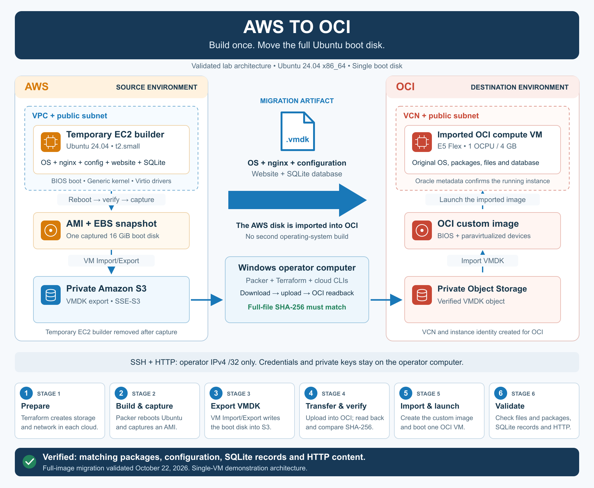

# AWS to OCI golden image migration

Build one Ubuntu server in AWS, capture its boot disk, and run that exported disk
in Oracle Cloud Infrastructure (OCI). Ubuntu, nginx, configuration files, website
content and a local SQLite database move together.

**Ready to reproduce as a lab.** The full migration passed on October 22, 2026:
the OCI VM booted, source and destination file hashes matched, package versions
and database records matched, and the HTTP checks passed. See the
[validation record](docs/full-image-validation.md). This sample prepares a fresh
demonstration server; adapting an existing production server requires additional
compatibility checks and a migration plan.

## Architecture



[Download the diagram as PNG](docs/images/aws-to-oci-architecture.png) ·
[Edit the SVG](docs/images/aws-to-oci-architecture.svg)

The sample uses **one boot disk and one destination VM**. The SQLite database is
inside that disk. Networking, security rules, instance identity and public IPs are
created separately in each cloud. Load balancers, managed databases and additional
data disks are outside this lab's scope.

## Start here

```powershell
git clone https://github.com/Johnadewumi25/aws-to-oci-golden-image.git
cd aws-to-oci-golden-image
```

You can also select **Code → Download ZIP** on GitHub and extract the project.

**Next: open the [reader setup guide](docs/sample-code.md).** It walks through
local configuration, infrastructure creation, the image build, export, transfer,
OCI import and final checks. Run its commands from the project root in order.
Replace every example value with your own before creating resources.

| What you need | Lab configuration |
| --- | --- |
| Operator computer | Windows with PowerShell and OpenSSH; WSL is not required |
| Cloud access | AWS CLI `default` profile and OCI CLI `DEFAULT` profile, with permissions for the lab resources |
| Tools | AWS CLI v2, OCI CLI, Terraform 1.10–1.x, Packer 1.14–1.x and Python 3.10+ |
| AWS source | A current Canonical Ubuntu 24.04 AMD64 non-Marketplace AMI in your selected region |
| Local storage | At least 30 GB free for the VMDK and its verification download |
| Your inputs | Public IPv4 `/32`, SSH public key, OCI compartment and availability domain, and a unique build version |

The examples use AWS `us-west-1` and OCI `us-phoenix-1`. The setup guide explains
how to change the regions. AWS export requires an **unencrypted staging EBS disk**;
use demonstration data. Both object storage buckets are private and encrypted at
rest. Credentials and private keys remain on your computer.

## The six migration stages

| Stage | Action | Check before continuing |
| --- | --- | --- |
| 1. Prepare | Terraform creates AWS export infrastructure and OCI storage/network | Plans reviewed; Terraform outputs saved locally |
| 2. Build | Packer provisions, reboots and captures the AWS server | Source report and AMI manifest exist |
| 3. Export | AWS VM Import/Export writes a VMDK into S3 | Export task reports `completed` |
| 4. Transfer | Download, upload into OCI, then download the OCI object for comparison | Full-file SHA-256 digests match |
| 5. Import and launch | Create the OCI custom image, then launch its VM | Image is Available; instance is Running |
| 6. Validate | Compare packages, configuration, SQLite records, metadata and HTTP | `.artifacts/full-image-result.json` reports `passed` |

Reading an AWS AMI ID selects the source image. The **export, transfer and import**
stages move its disk into OCI. OCI does not perform a second operating-system build.

## Where are the instances after the run?

Packer automatically removes the temporary AWS EC2 builder after a successful
capture. To find its retained image, open **EC2 → Images → AMIs → Owned by me** in
your build region. The OCI VM is under **Compute → Instances** in your selected
OCI region and compartment, named `aws-disk-imported-to-oci`.

The sample website uses `http://<your-oci-public-ip>/`. SSH and HTTP access are
restricted to the operator IPv4 `/32` you configured. If that address changes,
update `admin_cidr`, inspect the Terraform plans and apply them before reconnecting.
HTTPS is not configured by this lab.

## Check the source without launching resources

```powershell
python -m unittest discover -s tests -p test_full_image.py -v
terraform -chdir=terraform/full-image/aws init -backend=false
terraform -chdir=terraform/full-image/aws validate
terraform -chdir=terraform/full-image/oci init -backend=false
terraform -chdir=terraform/full-image/oci validate
packer validate -syntax-only packer/full-image
```

Terraform initialization downloads the required providers. These checks do not
build an image or deploy the lab. Successful source checks are followed by the
actual cloud build and migration checks in the setup guide.

## Costs, cleanup and project files

Compute, disks, snapshots, images, public IPv4 addresses, storage requests and
transfers can incur charges. A successful run retains the OCI VM and cloud image
artifacts until you remove them. Follow the
[cleanup instructions](docs/full-image-migration.md#costs-and-cleanup); Packer-created
AMIs and snapshots need separate cleanup from Terraform-managed resources.

- [Reader setup guide](docs/sample-code.md): commands and values to configure.
- [Detailed walkthrough](docs/full-image-migration.md): how each stage works.
- [Completed article](docs/article-full-image-aws-to-oci.md): the project narrative and results.
- [Validation record](docs/full-image-validation.md): evidence from the completed lab run.
- `packer/full-image`: AWS image template and example variables.
- `terraform/full-image`: AWS export and OCI import infrastructure.
- `terraform/oci`: the destination module's shared network module.
- `scripts/full-image`: preparation, export, transfer and verification helpers.

The sample is [MIT licensed](LICENSE). Local credentials, private keys, variable
files, Terraform state, reports and exported VM disks are excluded from the
source package and Git. The local `.artifacts` directory holds your run's evidence.
